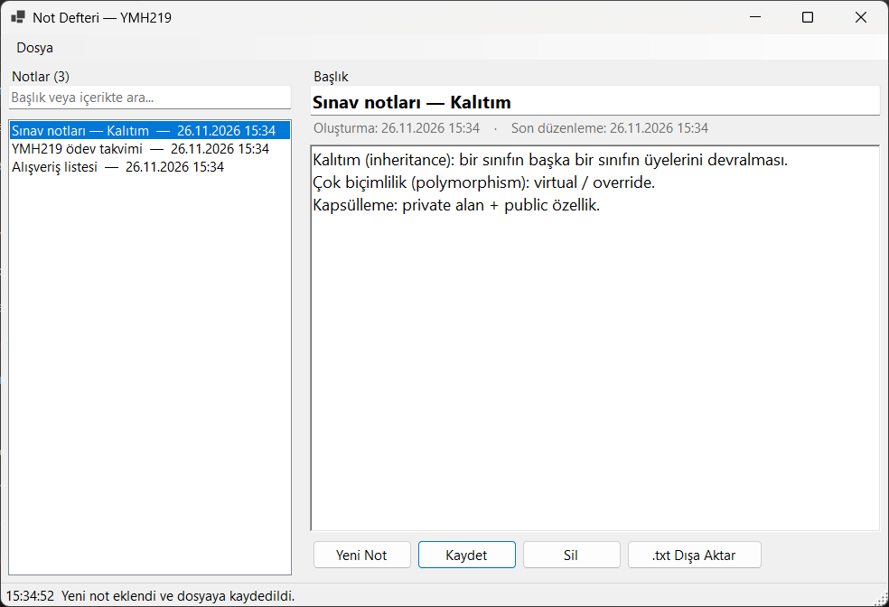
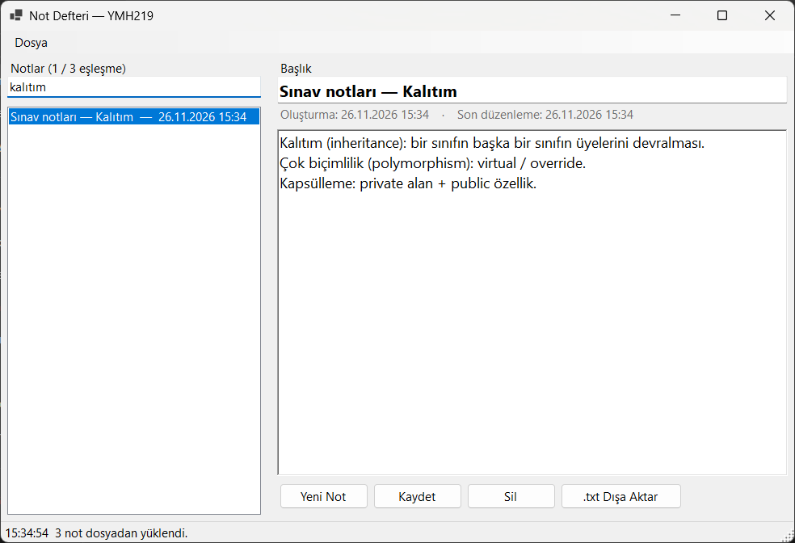
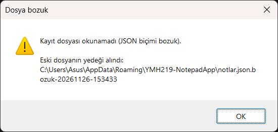

# YMH219 – Not Defteri (NotepadApp)

Notları bilgisayarda kalıcı olarak saklayan bir Windows Forms not defteri uygulaması.
Notlar `Not` sınıfının nesneleri olarak bir `List<Not>` içinde tutulur, **JSON** biçiminde
dosyaya serileştirilerek kaydedilir ve uygulama her açıldığında otomatik olarak geri yüklenir.

Nesne Tabanlı Programlama (YMH 219) dersi ek uygulama ödevi — *Dosya İşlemleri + Serileştirme*.

## Ekran görüntüleri

| Not listesi ve düzenleme | Arama ve tarih bilgisi |
|---|---|
|  |  |

Kayıt dosyası bozuk olduğunda uygulama kapanmaz; dosyanın yedeğini alır ve kullanıcıyı uyarır:



## Kullanılan teknolojiler

- C# / .NET 10 (`net10.0-windows`)
- Windows Forms
- `System.Text.Json` — serileştirme (serialize / deserialize)
- `System.IO` — `File`, `StreamWriter`, `Path`, `Directory`
- Harici NuGet paketi **yok**; her şey .NET'in kendi kütüphaneleriyle yapıldı.

## Kurulum ve çalıştırma

Gereksinim: Windows, [.NET 10 SDK](https://dotnet.microsoft.com/download) (Visual Studio 2026 ile birlikte gelir).

**Visual Studio ile:** `NotepadApp.sln` dosyasını açın ve **F5** ile çalıştırın.

**Komut satırından:**

```powershell
git clone https://github.com/SuleymanKilincc/YMH219-NotepadApp.git
cd YMH219-NotepadApp
dotnet run --project NotepadApp
```

Notlar şu dosyada saklanır: `%AppData%\YMH219-NotepadApp\notlar.json`

## Özellikler

- Başlık ve içerikten oluşan not **ekleme, listeleme, düzenleme ve silme**
- Her notun **oluşturma** ve **son düzenleme** tarihi tutulur ve gösterilir
- Notlar JSON dosyasına kaydedilir; uygulama açılışında **otomatik geri yüklenir**
- Her ekleme / güncelleme / silme işleminden sonra **otomatik kayıt**
- Seçili notu **.txt olarak dışa aktarma**
- Başlıkta veya içerikte **arama / filtreleme**
- Kaydedilmemiş değişiklik varken başka nota geçerken, yeni not açarken veya kapatırken **uyarı**
- Hata yönetimi:
  - Kayıt dosyası yoksa → boş not defteriyle başlar, durum çubuğunda bildirir
  - Dosya bozuksa (geçersiz JSON) → dosyanın yedeğini alır (`notlar.json.bozuk-<tarih>`), kullanıcıyı uyarır
  - Okuma / yazma hatası (izin, disk vb.) → uygulama kapanmadan hata mesajı gösterir
  - Dosyaya önce geçici dosya (`.tmp`) olarak yazılır, sonra asıl dosyanın yerine konur; yazma yarıda kesilirse eski kayıt bozulmaz
- Klavye kısayolları: **Ctrl+S** kaydet, **Ctrl+E** dışa aktar, **F5** dosyadan yeniden yükle

## Proje yapısı ve sınıf tasarımı

```
NotepadApp/
├── Models/Not.cs           # Tek bir not: Id, Baslik, Icerik, OlusturmaTarihi, DuzenlemeTarihi
├── Services/NotDeposu.cs   # List<Not> yönetimi + JSON kaydet/yükle + .txt dışa aktarma
├── AnaForm.cs              # Olay (event) işleyicileri: buton, menü, liste seçimi, arama
├── AnaForm.Designer.cs     # Form tasarımı (Visual Studio Designer ile açılabilir)
└── Program.cs              # Giriş noktası
```

- **`Not`** (model): Verinin kendisi. `Guncelle()` metodu düzenleme tarihini de günceller;
  böylece bu kural tek bir yerde durur.
- **`NotDeposu`** (servis): Not listesini kapsüller. Liste dışarıya `IReadOnlyList<Not>` olarak
  verilir; ekleme/silme yalnızca `Ekle()` / `Sil()` metotlarıyla yapılabilir. Dosya ve JSON
  ayrıntıları yalnızca bu sınıftadır.
- **`AnaForm`** (arayüz): Kullanıcı olaylarını karşılar, işi `NotDeposu`'na yaptırır, sonucu
  ekranda gösterir ve hataları kullanıcıya bildirir.

## Bilinen sınırlamalar / geliştirme notları

- İçerik düz metin olarak saklanır; RichTextBox biçimlendirmesi (kalın, renk vb.) kaydedilmez.
- Kategori / etiket desteği yoktur.
- Aynı anda iki uygulama penceresi açılırsa son kaydeden diğerinin değişikliklerinin üzerine yazar.

## Öğrenci

- **Ad Soyad:** Süleyman Kılınç
- **Öğrenci No:** 250541031
